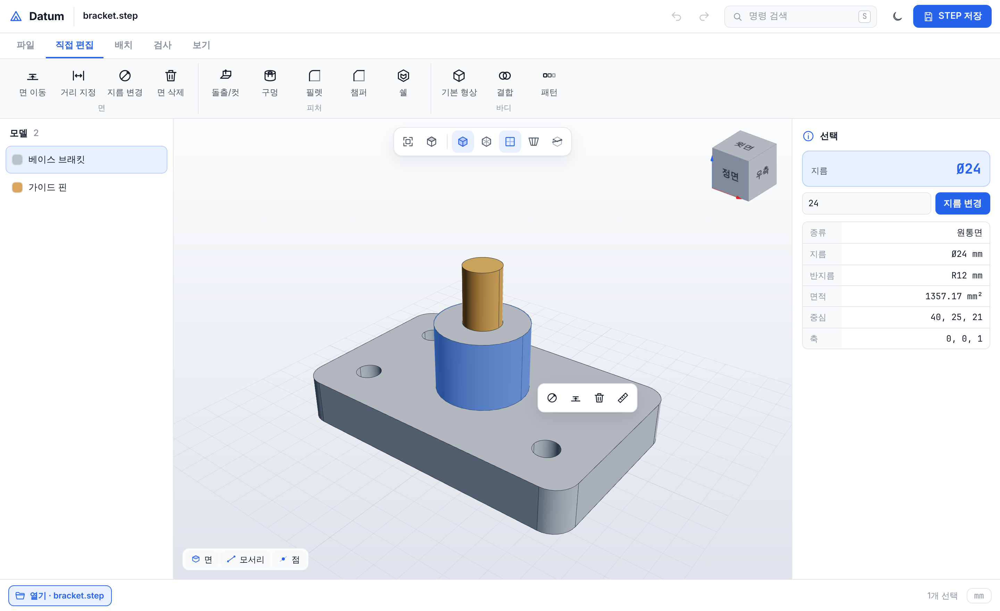

# Datum — STEP 직접 편집 3D CAD

> **Datum(데이텀)**: 설계에서 모든 치수의 출발점이 되는 기준면·기준축을 뜻하는 말.
> 남이 만든 STEP 파일도 내 기준으로 다시 잡아 고친다는 뜻으로 지었다.



솔리드웍스·퓨전 360·온쉐이프·스페이스클레임을 벤치마킹한 개인용 CAD다. STEP(.step/.stp)을 열어
**치수를 재고, 그 자리에서 치수를 바꾸고, 다시 STEP으로 저장**하는 데 집중했다. 형상은 솔리드웍스와
같은 B-Rep 정밀 형상(OpenCascade 커널)이라 원·원통이 실제 곡면으로 유지되고, 부품 이름과 색상도
보존된다.

## 실행

| OS | 방법 |
|---|---|
| Windows | `run_windows.bat` 더블클릭 (Python 3.10 이상 필요, 첫 실행 때 자동 설치) |
| macOS / Linux | `./run.sh` |

Edge나 Chrome이 있으면 주소창 없는 앱 창으로 열린다. 서버는 `127.0.0.1`에서만 돌아 파일이 PC 밖으로 나가지 않는다.

```bash
pip install -r requirements.txt
python server.py            # 브라우저 자동 실행
python server.py --no-browser
```

## 벤치마킹해서 가져온 것

| 출처 | 가져온 아이디어 | Datum에서 |
|---|---|---|
| 스페이스클레임 | 이력 없이 면을 직접 당기고 옮기는 편집 | **면 이동**, **거리 지정**, **지름 변경** — 이웃 면이 자동으로 따라온다 |
| 솔리드웍스 | 측정 도구, 상황별 툴바, 명령 검색, 마우스 조작 | 클릭 즉시 치수 표시, 선택 옆 미니 툴바, `S` 명령 검색, 가운데 버튼 회전 |
| 퓨전 360 | 하단 타임라인 | 작업마다 칩이 쌓이고, 클릭하면 그 시점으로 되돌아갔다 다시 올 수 있다 |
| 온쉐이프 | 뷰큐브, 깔끔한 플랫 UI | 클릭하는 뷰큐브(면·모서리·꼭짓점), 밝게/어둡게 테마 |

## 기능

| 탭 | 기능 |
|---|---|
| 파일 | 새 문서, 열기(끌어다 놓기), 가져오기(조립품 위치 유지), STEP 저장(이름·색 보존), STL, 화면 PNG |
| 직접 편집 | 면 이동, 거리 지정, 지름 변경(구멍·축·필렛 반지름), 면 삭제, 돌출/컷, 구멍, 필렛, 챔퍼, 쉘, 기본 형상, 결합(합치기·빼기·교차), 패턴(선형·원형) |
| 배치 | 이동, 회전, 크기(균일·축별), 대칭, 복사, 바디 삭제 |
| 어셈블리 | 메이트(일치·거리·동심·평행·수직), 고정/해제, 재생성, 간섭 검사, 분해 보기 — 메이트 목록에서 거리 수정·삭제 |
| 시뮬레이션 | 정적 응력 해석(FEA): 재질 7종·직접 입력, 고정 면, 힘(N)/압력(MPa) 하중, 메시 밀도 → von Mises 응력·변위 컬러 플롯, 변형 배율, 안전계수 |
| 검사 | 측정(길이·지름·면적·좌표·법선 / 최소·평행·중심 거리, dX·dY·dZ, 각도), 질량 특성(재질 선택), 단면도 |
| 보기 | 정면·후면·좌·우·윗면·아랫면·등각, 전체 보기, 음영/와이어, 모서리, 원근/평행, mm/inch |

**치수를 바로 바꾸는 법** — 평행한 두 평면을 클릭하면 오른쪽에 평행 거리와 입력칸이 뜬다. 새 값을 넣고
`거리 변경`을 누르면 두 번째로 고른 면이 옮겨진다. 원통면(구멍, 축, 필렛)을 클릭하면 같은 방식으로 지름을 바꾼다.

## 조작 — 솔리드웍스 기본 단축키와 같게

| 동작 | 조작 |
|---|---|
| 회전 / 이동 / 확대 | 가운데 드래그 / Ctrl+가운데 / 휠, Shift+가운데 드래그 |
| 보기 방향 | `Space` 메뉴, `Ctrl+1` 정면 `Ctrl+2` 후면 `Ctrl+3` 좌측 `Ctrl+4` 우측 `Ctrl+5` 윗면 `Ctrl+6` 아랫면 `Ctrl+7` 등각, `Ctrl+8` 면에 수직 |
| 화면 회전 | `←↑→↓` 15°, `Shift`+방향키 90°, `Alt+←/→` 롤, `Ctrl`+방향키 이동 |
| 확대 / 전체 | `Z` 축소, `Shift+Z` 확대, `F` 전체 보기 |
| 명령 | `S` 명령 검색, `Enter` 마지막 명령 반복, `Ctrl+M` 메이트, `Ctrl+B`/`Ctrl+Q` 재생성 |
| 편집 | `Ctrl+Z`/`Ctrl+Y` 취소·다시, `Ctrl+C`/`Ctrl+V` 부품 복사·붙여넣기, `Delete` 면 삭제, `Esc` 선택 해제 |
| 파일 | `Ctrl+N` 새 문서, `Ctrl+O` 열기, `Ctrl+S` STEP 저장 |

솔리드웍스에는 없는 추가 단축키: `M` 측정, `O` 면 이동, `D` 거리 지정, `E` 돌출, `H` 구멍, `R` 필렛, `C` 챔퍼, `B` 결합, `P` 패턴, `T` 이동, `X` 단면.

## 시뮬레이션 정확도

2차 사면체(10절점) 요소를 쓴다. 외팔보(100×10×10 mm, 강철, 끝단 100 N)로 검증한 결과:

| 항목 | 이론값 | Datum |
|---|---|---|
| 끝단 처짐 | 0.1905 mm | 0.1908 mm |
| 최대 굽힘응력 | 60 MPa | 60.6 MPa |
| 분포하중 처짐(1 MPa) | 0.7143 mm | 0.7156 mm |

선형 탄성 정적 해석만 한다(접촉, 대변형, 소성, 진동·열 해석은 없음). 고정 면 모서리의 응력 집중은 실제보다 크게 나올 수 있다.

## 구조

```
datum/
├── server.py          로컬 서버(FastAPI): 화면 ↔ 엔진, 메시 캐시, 앱 창 실행
├── core/
│   ├── geometry.py    형상 엔진(OpenCascade): 측정, 면 오프셋, 피처, 불리언, 패턴, 메시
│   ├── stepio.py      STEP 입출력(XDE): 부품 이름·색, 조립품 위치
│   ├── assembly.py    메이트 풀이, 간섭 검사
│   ├── fea.py         정적 응력 해석(gmsh 메시 + T10 요소 + AMG 풀이)
│   └── document.py    문서: 바디, 타임라인, 실행 취소/다시/시점 이동
├── web/               화면: index.html, style.css, icons.js(자체 아이콘), app.js(three.js)
├── samples/           예제 STEP
└── tests/             엔진 테스트(pytest)
```

```bash
python -m pytest tests   # 21개
```

## 한계

- STEP에는 설계 이력이 없으므로 솔리드웍스식 피처 트리 재계산 대신 직접 편집 방식이다.
- 면 단위 색상, 스케치, 도면, 동작(모션) 시뮬레이션은 아직 없다. 부품을 마우스로 끌어 메이트 안에서 움직이는 기능도 없다(수치 이동 후 재생성).
- Linux에서는 gmsh용 `libglu1-mesa` 패키지가 필요하다(Windows·macOS는 설치 불필요).
- 면 이동은 OpenCascade 커널 한계로 아주 복잡한 형상에서는 실패할 수 있다(실패하면 원본 유지).
