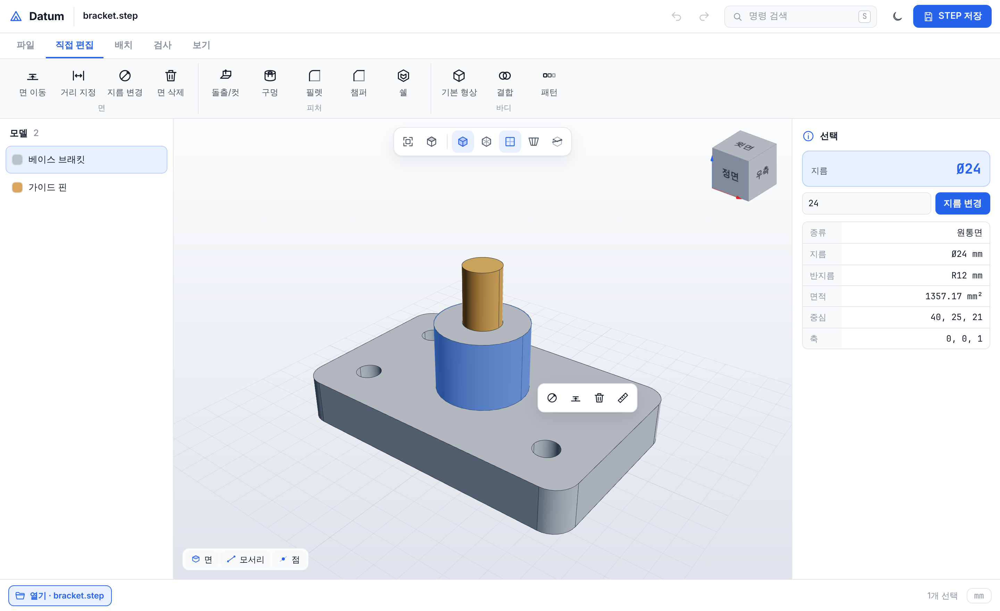

# 혁신3D — 개인용 3D CAD (Windows 11)

> 영문·파일 이름: **Hyeoksin3D**



솔리드웍스·퓨전 360·온쉐이프·스페이스클레임을 벤치마킹한 개인용 CAD다. STEP(.step/.stp)을 열어
**치수를 재고, 그 자리에서 치수를 바꾸고, 다시 STEP으로 저장**하는 데 집중했다. 형상은 솔리드웍스와
같은 B-Rep 정밀 형상(OpenCascade 커널)이라 원·원통이 실제 곡면으로 유지되고, 부품 이름과 색상도
보존된다.

## 설치 (Windows 11)

혁신3D는 **Windows 11 전용 데스크톱 프로그램**으로 배포한다. 브라우저 없이 자체 창(Windows 11에 기본 포함된 Edge WebView2)으로
열리고, 모든 계산은 내 PC 안에서만 한다(인터넷 연결 불필요, 내부 주소 127.0.0.1만 사용).

1. GitHub 저장소 → **Actions** → **Hyeoksin3D Windows build** → 가장 최근 성공한 실행 → 아래 **Artifacts**에서
   `Hyeoksin3D-Setup-Windows11`을 내려받아 압축을 푼다.
2. `Hyeoksin3D-Setup-0.6.0.exe` 실행 → 설치(관리자 권한 불필요, 내 계정에만 설치).
   - 처음 실행할 때 Windows SmartScreen이 "알 수 없는 게시자"라고 막으면 **추가 정보 → 실행**을 누른다(개인용이라 코드 서명을 하지 않았다).
   - 설치 중 "STEP 파일을 혁신3D로 열기"를 고르면 탐색기에서 .step 파일을 더블클릭해 바로 열 수 있다.
3. 시작 메뉴 또는 바탕 화면의 **혁신3D**으로 실행.

설치 없이 쓰려면 `Hyeoksin3D-portable` 압축을 풀고 `Hyeoksin3D\Hyeoksin3D.exe`를 실행한다.
직접 빌드하려면 `build_windows.bat`(Python 3.12 필요)을 실행한다. 개발 중에는 `run_windows.bat`(브라우저로 실행)도 쓸 수 있다.

문제가 생기면 `%LOCALAPPDATA%\Hyeoksin3D\hyeoksin3d.log`를 확인하고, `Hyeoksin3D.exe --selftest 결과.txt`(엔진)와 `Hyeoksin3D.exe --guitest 결과.txt`(실제 창)로 점검할 수 있다.

## 벤치마킹해서 가져온 것

| 출처 | 가져온 아이디어 | 혁신3D에서 |
|---|---|---|
| 스페이스클레임 | 이력 없이 면을 직접 당기고 옮기는 편집 | **면 이동**, **거리 지정**, **지름 변경** — 이웃 면이 자동으로 따라온다 |
| 솔리드웍스 | 측정 도구, 상황별 툴바, 명령 검색, 마우스 조작 | 클릭 즉시 치수 표시, 선택 옆 미니 툴바, `S` 명령 검색, 가운데 버튼 회전 |
| 퓨전 360 | 하단 타임라인 | 작업마다 칩이 쌓이고, 클릭하면 그 시점으로 되돌아갔다 다시 올 수 있다 |
| 온쉐이프 | 뷰큐브, 깔끔한 플랫 UI | 클릭하는 뷰큐브(면·모서리·꼭짓점), 밝게/어둡게 테마 |

## 기능

| 탭 | 기능 |
|---|---|
| 파일 | 새 문서, 열기(끌어다 놓기), 가져오기(조립품 위치 유지), STEP 저장(이름·색 보존), STL, 화면 PNG |
| 스케치 | 평면(또는 XY·XZ·YZ 기준면) 위에 선·사각형·원·호, 격자·끝점 스냅, 수평/수직 자동, 치수 숫자를 클릭해 크기 지정 → 돌출 추가·잘라내기(관통·양방향)·새 바디. 윤곽 안의 윤곽은 구멍 |
| 직접 편집 | 면 이동, 거리 지정, 지름 변경(구멍·축·필렛 반지름), 면 삭제, 돌출/컷, 구멍, 필렛, 챔퍼, 쉘, 기본 형상, 결합(합치기·빼기·교차), 패턴(선형·원형) |
| 배치 | 이동, 회전, 크기(균일·축별), 대칭, 복사, 바디 삭제 |
| 어셈블리 | 부품을 마우스로 끌어 이동(Shift+끌기: 회전) — 메이트가 허용하는 방향으로만 움직임, 메이트(일치·거리·동심·평행·수직), 고정/해제, 재생성, 간섭 검사, 분해 보기 — 메이트 목록에서 거리 수정·삭제 |
| 시뮬레이션 | 정적 응력 해석(FEA): 재질 7종·직접 입력, 고정 면, 힘(N)/압력(MPa) 하중, 메시 밀도 → von Mises 응력·변위 컬러 플롯, 변형 배율, 안전계수 |
| 도면 | 3D → 2D 도면: 정면·평면·우측면·등각도(3각법, 은선 표시), 자동 척도·배치, 자동 치수(전체 크기·n×Ø·R·구멍 위치), 스마트 치수·지름/반지름·주기 추가, **단면도(해칭)·상세도**, **기하 공차 기입틀 14종·데이텀·표면 거칠기**, 뷰 끌어 옮기기, 치수 끌어 옮기기, 공차 문자(`<> ±0.1`), 표제란, **PDF·DXF·SVG** 내보내기 |
| 검사 | 측정(길이·지름·면적·좌표·법선 / 최소·평행·중심 거리, dX·dY·dZ, 각도), 질량 특성(재질 선택), 단면도 |
| 보기 | 정면·후면·좌·우·윗면·아랫면·등각, 전체 보기, 음영/와이어, 모서리, 원근/평행, mm/inch |

**치수를 바로 바꾸는 법** — 평행한 두 평면을 클릭하면 오른쪽에 평행 거리와 입력칸이 뜬다. 새 값을 넣고
`거리 변경`을 누르면 두 번째로 고른 면이 옮겨진다. 원통면(구멍, 축, 필렛)을 클릭하면 같은 방식으로 지름을 바꾼다.

## 조작 — 솔리드웍스 기본 단축키와 같게

| 동작 | 조작 |
|---|---|
| 회전 / 이동 / 확대 | 가운데 드래그 / Ctrl+가운데 / 휠, Shift+가운데 드래그 |
| 보기 방향 | `Space` 메뉴, `Ctrl+1` 정면 `Ctrl+2` 후면 `Ctrl+3` 좌측 `Ctrl+4` 우측 `Ctrl+5` 윗면 `Ctrl+6` 아랫면 `Ctrl+7` 등각, `Ctrl+8` 면에 수직 |
| 화면 회전 | `←↑→↓` 15°, `Shift`+방향키 90°, `Alt+←/→` 롤, `Ctrl`+방향키 이동 |
| 확대 / 전체 | `Z` 축소, `Shift+Z` 확대, `F` 전체 보기 |
| 명령 | `S` 명령 검색, `Enter` 마지막 명령 반복, `Ctrl+M` 메이트, `Ctrl+B`/`Ctrl+Q` 재생성 |
| 편집 | `Ctrl+Z`/`Ctrl+Y` 취소·다시, `Ctrl+C`/`Ctrl+V` 부품 복사·붙여넣기, `Delete` 면 삭제, `Esc` 선택 해제 |
| 파일 | `Ctrl+N` 새 문서, `Ctrl+O` 열기, `Ctrl+S` STEP 저장 |

솔리드웍스에는 없는 추가 단축키: `M` 측정, `O` 면 이동, `D` 거리 지정, `E` 돌출, `H` 구멍, `R` 필렛, `C` 챔퍼, `B` 결합, `P` 패턴, `T` 이동, `X` 단면.

## 도면 만들기

`도면` 탭 → **도면 만들기**(Ctrl+D). 대상 부품, 용지(A4~A1), 척도(자동 또는 10:1~1:50), 투상도를 고르면 KS 3각법으로
배치되고 기본 치수가 자동으로 붙는다.

| 도구 | 사용법 |
|---|---|
| 치수 (D) | 선 끝점·원 중심 두 곳을 클릭 → 마우스를 위·아래로 빼면 수평, 좌·우로 빼면 수직 치수 → 클릭해서 놓기 |
| Ø / R | 원이나 호의 테두리를 클릭 |
| 단면 | 수평/수직을 고르고 부모 뷰 위 절단 위치를 클릭 → 단면도를 놓을 곳 클릭. 절단면은 자동 해칭, 부모 뷰에 A-A 절단선·화살표 |
| 상세 | 확대할 곳 중심 클릭 → 원 크기 클릭 → 놓을 곳 클릭(2·3·4·5·10배) |
| 기하공차 | 14종(진직도·평면도·진원도·원통도·선/면의 윤곽도·평행도·직각도·경사도·위치도·동심도·대칭도·원주/온 흔들림), 공차값, Ø, Ⓜ/Ⓛ, 데이텀 3개 → 지시할 선 클릭 → 놓을 곳 클릭 |
| 데이텀 · 거칠기 | 데이텀 삼각형+문자 상자, 표면 거칠기(Ra) 기호 |
| 뷰 이동 | 선택 도구로 뷰를 끌면 치수·지시선이 함께 움직인다. 단면·상세도는 Delete로 지운다 |
| 주기 | 클릭한 곳에 문장(예: 일반 공차) |
| 편집 | 치수를 끌어 옮기기, 더블클릭해서 문자 수정(`<>`가 측정값), Delete로 삭제 |
| 출력 | PDF(인쇄용, 맑은 고딕), DXF(AutoCAD 등, 레이어 외형선·숨은선·중심선·치수·문자), SVG |

치수는 모델 좌표에 붙어 있어서 3D 형상을 고친 뒤 도면을 다시 열면 값이 새 형상에 맞게 바뀐다. DXF의 치수는
선·문자로 분해된 형태(DIMENSION 개체 아님)다.

## 시뮬레이션 정확도

2차 사면체(10절점) 요소를 쓴다. 외팔보(100×10×10 mm, 강철, 끝단 100 N)로 검증한 결과:

| 항목 | 이론값 | 혁신3D |
|---|---|---|
| 끝단 처짐 | 0.1905 mm | 0.1908 mm |
| 최대 굽힘응력 | 60 MPa | 60.6 MPa |
| 분포하중 처짐(1 MPa) | 0.7143 mm | 0.7156 mm |

선형 탄성 정적 해석만 한다(접촉, 대변형, 소성, 진동·열 해석은 없음). 고정 면 모서리의 응력 집중은 실제보다 크게 나올 수 있다.

## 구조

```
hyeoksin3d/
├── desktop.py         Windows 앱 진입점(WebView2 창, 저장 창, 자체 점검)
├── server.py          로컬 서버(FastAPI): 화면 ↔ 엔진, 메시 캐시, 앱 창 실행
├── core/
│   ├── geometry.py    형상 엔진(OpenCascade): 측정, 면 오프셋, 피처, 불리언, 패턴, 메시
│   ├── stepio.py      STEP 입출력(XDE): 부품 이름·색, 조립품 위치
│   ├── assembly.py    메이트 풀이, 간섭 검사
│   ├── drawing.py     도면: HLR 투상, 배치·척도, 자동 치수, PDF·DXF 출력
│   ├── sketch.py      스케치 윤곽 → 면 → 돌출/컷
│   ├── fea.py         정적 응력 해석(gmsh 메시 + T10 요소 + AMG 풀이)
│   └── document.py    문서: 바디, 타임라인, 실행 취소/다시/시점 이동
├── web/               화면: index.html, style.css, icons.js, app.js(three.js 3D), drawing.js(도면 편집기), sketch.js(스케치)
├── packaging/         PyInstaller 설정, Inno Setup 설치 스크립트, 아이콘
├── samples/           예제 STEP
└── tests/             엔진 테스트(pytest)
```

```bash
python -m pytest tests   # 25개
```

## 한계

- STEP에는 설계 이력이 없으므로 솔리드웍스식 피처 트리 재계산 대신 직접 편집 방식이다.
- 스케치는 치수 값을 직접 지정하는 방식이며, 솔리드웍스처럼 구속(일치·평행·접선 등)을 풀어 주는 해석기는 없다.
- 동작(모션) 시뮬레이션, 진동·열 해석, 면 단위 색상은 아직 없다.
- Linux에서는 gmsh용 `libglu1-mesa` 패키지가 필요하다(Windows·macOS는 설치 불필요).
- 면 이동은 OpenCascade 커널 한계로 아주 복잡한 형상에서는 실패할 수 있다(실패하면 원본 유지).
